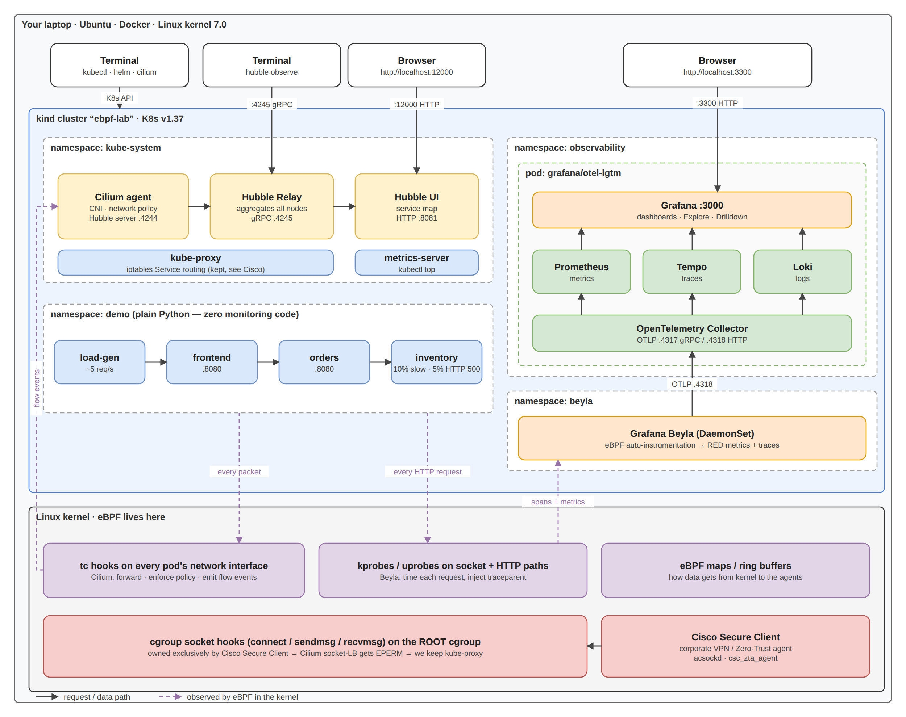

# eBPF Observability Lab

> **Goal:** get full observability of an app — who talks to whom, latency, error rates,
> distributed traces — **without adding a single line of monitoring code to the app.**
> Everything comes from **eBPF** watching the Linux kernel.
>
> **Cost:** ₹0. Runs entirely on a laptop (kind + Docker). All tools are open source.

---

## Table of contents

1. [What is eBPF? (the 5-minute version)](#1-what-is-ebpf-the-5-minute-version)
2. [The tools we use and why](#2-the-tools-we-use-and-why)
3. [What we are building](#3-what-we-are-building)
4. [Setup, step by step](#4-setup-step-by-step)
5. [Exploring: what to look at](#5-exploring-what-to-look-at)
6. [Lessons learned (the real-world stuff)](#6-lessons-learned-the-real-world-stuff)
7. [Next experiments](#7-next-experiments)
8. [Cheat sheet](#8-cheat-sheet)
9. [Progress log](#9-progress-log)

---

## 1. What is eBPF? (the 5-minute version)

### The problem it solves

Traditionally, to see what an app is doing you had to **change the app**:
add a Prometheus client library, add OpenTelemetry SDK calls, add log lines, redeploy.
That is slow, every language needs its own library, and you can't do it for apps you
don't own (vendor binaries, legacy code).

But every single thing an app does — open a socket, send an HTTP request, read a file —
goes **through the Linux kernel**. So if you could watch the kernel, you could see everything,
for every app, in every language, with zero code changes.

### What eBPF actually is

**eBPF = a tiny, safe virtual machine inside the Linux kernel.**
You write a small program, load it into the kernel, and *attach* it to an event ("hook").
Every time that event happens, your program runs.

```
     user space (your apps)                 kernel space
 ┌──────────────────────────┐      ┌──────────────────────────────────┐
 │ python app: send(socket) │ ───► │  syscall ──► [hook] ──► network  │
 └──────────────────────────┘      │                │                 │
                                   │          eBPF program runs:      │
 ┌──────────────────────────┐      │          "record: pod X sent     │
 │ Beyla / Cilium agent     │ ◄─── │           HTTP GET /orders,      │
 │ reads the data, exports  │ maps │           took 42ms"             │
 └──────────────────────────┘      └──────────────────────────────────┘
```

Analogy: the kernel is a **highway**. Instead of putting a tracker in every car (SDKs in every app),
eBPF installs **cameras on the highway** that see every car that passes.

### Key words you'll hear

| Term | Meaning |
|------|---------|
| **Hook** | The event an eBPF program attaches to. Examples below. |
| **kprobe / kretprobe** | Hook on *any kernel function* entry/exit (e.g. `tcp_sendmsg`). |
| **uprobe** | Hook on a function *inside a user program* (e.g. Go's `net/http.(*Server).ServeHTTP`). |
| **tracepoint** | Stable, pre-defined kernel hooks (e.g. `sched:sched_process_exec`). |
| **tc (traffic control)** | Hook on network packets entering/leaving a network interface. Cilium lives here. |
| **XDP** | Hook at the network driver, earliest possible point. Used for super-fast DDoS dropping/load-balancing. |
| **cgroup hooks** | Hook on socket operations (`connect`, `sendmsg`…) for all processes in a cgroup. Important in our lessons-learned! |
| **Verifier** | Kernel checks every eBPF program before loading: no infinite loops, no bad memory access. That's why eBPF is *safe* — it can't crash the kernel. |
| **Maps** | Shared key/value storage between the eBPF program (kernel) and the agent (user space). This is how data gets out. |
| **CO-RE / BTF** | "Compile Once, Run Everywhere" — lets one eBPF binary work across kernel versions. |

### Why everyone is talking about it

- **Networking:** Cilium replaces iptables with eBPF → faster, scales to huge clusters. (GKE Dataplane V2 *is* Cilium!)
- **Observability:** Beyla, Pixie, Hubble, Parca — instrumentation with zero code changes.
- **Security:** Tetragon, Falco — detect "a shell was spawned in a container" at the kernel level.
- **Real-world twist:** corporate VPN/security agents use it too — we hit this ourselves (see §6).

---

## 2. The tools we use and why

| Tool | What it is | What it gives us |
|------|-----------|------------------|
| **kind** | "Kubernetes IN Docker" — each k8s node is a Docker container | A free local cluster in ~1 minute |
| **Cilium** | A Kubernetes CNI (pod networking) built on eBPF | Pod networking + network policies, all in eBPF |
| **Hubble** | Cilium's observability layer | Live view of every network flow: who → whom, allowed/dropped, and a service-map UI |
| **Grafana Beyla** | eBPF auto-instrumentation agent (DaemonSet) | HTTP/gRPC request **rate, errors, duration** + **traces** for any app, any language |
| **OpenTelemetry (OTel)** | The industry-standard format/protocol (OTLP) for metrics, logs, traces | Beyla speaks OTLP, so any backend works |
| **Grafana LGTM** | One container: **L**oki (logs) + **G**rafana (UI) + **T**empo (traces) + **M**imir/Prometheus (metrics) + OTel Collector | Somewhere to store & visualize the data |

**Two layers of visibility — this is the key mental model:**

```
  Cilium/Hubble  →  NETWORK view  (L3/L4):  "frontend opened a TCP connection to orders:8080, allowed"
  Beyla          →  APP view      (L7):     "GET /orders returned 500 in 812ms, part of trace abc123"
```

### The three pillars of observability (if you're new to monitoring)

- **Metrics** — numbers over time. "requests/sec", "p95 latency", "error %". Cheap, great for dashboards & alerts.
- **Traces** — the journey of *one* request across services: `load-gen → frontend → orders → inventory`, with timing of each hop. Great for "*where* is it slow?".
- **Logs** — text events. Great for "*why* did it fail?".

The **RED method** (what to measure for any service): **R**ate, **E**rrors, **D**uration. Beyla gives you exactly these.

---

## 3. What we are building



Editable diagram: [architecture.drawio](architecture.drawio) (open in app.diagrams.net or the draw.io VS Code extension).
A Word write-up of the whole lab lives one folder up:
`../eBPF Observability on Kubernetes Seeing Everything Without Touching the Code.docx`.

```
 ┌──────────────────────── kind cluster "ebpf-lab" (Docker) ────────────────────────┐
 │                                                                                   │
 │  namespace: demo   (plain Python, NO monitoring code)                             │
 │    load-gen ──► frontend ──► orders ──► inventory                                 │
 │    (5 req/s)                            ├─ 10% of requests are slow (0.4–0.9s)    │
 │                                         └─ 5% return HTTP 500                     │
 │                                                                                   │
 │  kube-system:  Cilium agent (eBPF on tc) ──► Hubble Relay ──► Hubble UI           │
 │  beyla:        Beyla DaemonSet (eBPF probes) ──OTLP──┐                            │
 │  observability: LGTM pod (OTel collector → Prometheus/Tempo → Grafana) ◄──┘       │
 └───────────────────────────────────────────────────────────────────────────────────┘
```

The `inventory` service is deliberately broken (slow + errors). The challenge:
**find it using only eBPF data**, as if you didn't know.

### Files in this folder

```
ebpf-observability-lab/
├── README.md                    ← you are here
├── architecture.drawio / .png   ← architecture diagram (editable + image)
├── kind-config.yaml             ← cluster: no default CNI (Cilium replaces it)
├── values/
│   ├── cilium-values.yaml       ← Cilium + Hubble settings
│   └── beyla-values.yaml        ← what Beyla instruments & where it sends data
└── manifests/
    ├── demo-app.yaml            ← the 3 services + load generator
    └── lgtm.yaml                ← Grafana LGTM all-in-one backend
```

---

## 4. Setup, step by step

### 4.0 Prerequisites

| Tool | Version used | Install |
|------|-------------|---------|
| Docker | 29.1 | already installed |
| kubectl | 1.36 | already installed |
| helm | 3.21 | already installed |
| kind | 0.33.0 | binary → `~/.local/bin` |
| cilium CLI | 0.20.1 | binary → `~/.local/bin` |
| hubble CLI | 1.20.2 | binary → `~/.local/bin` |

Machine: Linux kernel 7.0, 14 CPU, 15 GB RAM. The whole lab uses about **2 GB RAM** (measured):

| Component | RAM |
|-----------|-----|
| Grafana LGTM (all-in-one) | ~700 MB |
| kube-apiserver | ~370 MB |
| Cilium agent | ~210 MB |
| Beyla | ~205 MB |
| everything else (etcd, scheduler, demo app…) | ~500 MB |

Not using it? `docker stop ebpf-lab-control-plane` pauses the whole cluster; `docker start` resumes it.

```bash
# Install kind, cilium, hubble CLIs (no sudo needed)
mkdir -p ~/.local/bin && cd /tmp
curl -fsSLo kind https://github.com/kubernetes-sigs/kind/releases/download/v0.33.0/kind-linux-amd64
install -m755 kind ~/.local/bin/kind
curl -fsSLO https://github.com/cilium/cilium-cli/releases/download/v0.20.1/cilium-linux-amd64.tar.gz
tar xzf cilium-linux-amd64.tar.gz -C ~/.local/bin
curl -fsSLO https://github.com/cilium/hubble/releases/download/v1.20.2/hubble-linux-amd64.tar.gz
tar xzf hubble-linux-amd64.tar.gz -C ~/.local/bin
export PATH=$HOME/.local/bin:$PATH        # add to ~/.bashrc to make permanent
```

> Always verify the `.sha256sum` files that come with each release — we did.

> ⚠️ **Context safety:** this lab is 100% local — no GCP/cloud account is used.
> But `~/.kube/config` also holds work GKE clusters, and `kubectl`/`helm`/`cilium` act on whatever the
> *current context* is. Before running anything from this lab, check:
> ```bash
> kubectl config current-context        # must say: kind-ebpf-lab
> kubectl config use-context kind-ebpf-lab
> ```

### 4.1 Create the cluster (no CNI)

```bash
cd ~/Documents/Personal/ebpf-observability-lab
kind create cluster --config kind-config.yaml
kubectl get nodes      # STATUS = NotReady  ← expected! no network plugin yet
```

**Why NotReady?** We disabled kind's default CNI (`kindnet`). A node isn't Ready until pods can get IPs. Cilium will fix that.

### 4.2 Install Cilium + Hubble

```bash
cilium install --values values/cilium-values.yaml
cilium status --wait
```

✅ Expected: `Cilium: OK`, `Operator: OK`, `Hubble Relay: OK`, node becomes `Ready`.

**What just happened:** the Cilium agent (DaemonSet) compiled and loaded eBPF programs onto
every pod's virtual network interface (tc hook). From now on, every packet in/out of every pod
passes through Cilium's eBPF code, which forwards it, enforces policy, and **reports it to Hubble**.

### 4.3 Deploy the backend (Grafana LGTM)

```bash
kubectl apply -f manifests/lgtm.yaml
kubectl -n observability rollout status deploy/lgtm
```

### 4.4 Deploy the demo app

```bash
kubectl apply -f manifests/demo-app.yaml
kubectl -n demo get pods      # 4 pods Running
```

Open `manifests/demo-app.yaml` and notice: **no** Prometheus, **no** OpenTelemetry, **no** tracing imports.
Only `http.server` and `urllib` from the Python standard library.

### 4.5 Install Beyla

```bash
helm repo add grafana https://grafana.github.io/helm-charts
helm repo update
helm install beyla grafana/beyla --version 1.16.11 \
  -n beyla --create-namespace -f values/beyla-values.yaml
kubectl -n beyla get pods
```

**What Beyla does on startup:**
1. Finds processes in pods of namespace `demo` (our `discovery` rule).
2. Inspects each binary (Python here) and attaches kprobes/uprobes on the networking + HTTP code paths.
3. For every request it sees, it builds a span (start, end, method, route, status code) and metrics.
4. Ships them via OTLP to the LGTM collector.

✅ Check it worked — Beyla logs should show one line per instrumented process:

```bash
kubectl -n beyla logs ds/beyla | grep "instrumenting process"
# level=INFO msg="instrumenting process" cmd=/usr/local/bin/python3.13 pid=8639 type=python ...   (x4)
```

Harmless warnings you can ignore on a laptop: `timed out while waiting for Cloud metadata` (no AWS/GCP/Azure here)
and `creating OTEL namespace in bpffs failed` (only disables optional log-enrichment features).

### 4.6 Tip: flaky network? Pre-pull images

If pods get stuck in `ImagePullBackOff` (we hit this — see §6), pull directly inside the kind node with retries:

```bash
docker exec ebpf-lab-control-plane crictl pull docker.io/grafana/beyla:3.32.0
```

### 4.7 metrics-server (for `kubectl top`)

`kubectl top` says `error: Metrics API not available` until you install **metrics-server** — a small add-on
that asks each kubelet for CPU/memory every 15s. Managed clusters (GKE, EKS) ship it; kind doesn't.

```bash
curl -fsSL -o manifests/metrics-server.yaml \
  https://github.com/kubernetes-sigs/metrics-server/releases/latest/download/components.yaml
# kind's kubelets use self-signed certs -> add this arg to the container (LAB ONLY, never in prod):
#   - --kubelet-insecure-tls
kubectl apply -f manifests/metrics-server.yaml
kubectl top nodes        # works after ~30-60s
```

> Note: metrics-server is **not** eBPF and **not** Prometheus — it only feeds `kubectl top` and the
> Horizontal Pod Autoscaler with "current CPU/memory". For history and dashboards you use Prometheus.

---

## 5. Exploring: what to look at

### 5.1 Hubble CLI — the network view

```bash
# Easiest: run hubble inside the Cilium agent pod (no port-forward needed)
alias hubble-k='kubectl -n kube-system exec ds/cilium -c cilium-agent -- hubble'
hubble-k observe --namespace demo --last 20

# Or expose Hubble Relay on localhost:4245 (own terminal tab; loop restarts it if it drops):
while true; do kubectl -n kube-system port-forward svc/hubble-relay 4245:80; sleep 1; done
# (Avoid `cilium hubble port-forward &` — on this setup it silently stops listening, see Lesson 5)

hubble status                                        # sanity check: "Healthcheck: Ok", "Connected Nodes: 1/1"

hubble observe --namespace demo --follow             # live stream of all flows
hubble observe --namespace demo --verdict DROPPED    # only blocked traffic
hubble observe --to-pod demo/orders --last 20        # who calls orders?
hubble observe --namespace demo -o json | head -1    # raw flow record (lots of metadata!)
```

Real output from our lab:

```
demo/load-gen-...:55762 (ID:39107) -> demo/frontend-...:8080 (ID:20268) to-endpoint FORWARDED (TCP Flags: ACK, FIN)
demo/frontend-...:56030 (ID:20268) <- demo/orders-...:8080  (ID:36863) to-endpoint FORWARDED (TCP Flags: ACK, PSH)
```

How to read it:
- `ID:20268` — Cilium **security identity**. Cilium doesn't think in IPs; it gives every set of pods with the
  same labels a numeric identity. Policies are enforced on identities → works even as pod IPs change.
- `to-endpoint` — packet delivered to a pod. `FORWARDED` = allowed. `DROPPED` would mean a policy blocked it.
- `TCP Flags` — `SYN` (open), `PSH` (data), `FIN` (close). You're literally watching TCP handshakes.

### 5.2 Hubble UI — the service map

```bash
cilium hubble ui        # opens http://localhost:12000
```

Pick namespace **demo** → you'll see a live graph `load-gen → frontend → orders → inventory`
drawn automatically from observed traffic. Nobody wrote this diagram — eBPF discovered it.

### 5.3 Grafana — the app view (metrics + traces)

```bash
kubectl -n observability port-forward svc/lgtm 3300:3000
# open http://localhost:3300   (login: admin / admin)  -- 3300 because port 3000 is already taken on this laptop
```

#### Metrics Beyla creates (OpenTelemetry semantic conventions)

| Metric | Type | Meaning |
|--------|------|---------|
| `http_server_request_duration_seconds` | histogram | Time to serve an incoming request (the service's own view) |
| `http_client_request_duration_seconds` | histogram | Time an outgoing call took (caller's view of a dependency) |
| `http_server_request_body_size_bytes` | histogram | Request payload size |

A **histogram** stores counts in latency buckets (`_bucket`), plus `_count` (number of requests) and `_sum` (total time).
From `_count` you get **Rate** and **Errors**; from `_bucket` you get **Duration** percentiles.

Every series is labelled automatically with `service_name`, `http_route`, `http_response_status_code`,
`k8s_namespace_name`, `k8s_deployment_name`, `k8s_pod_name`, `k8s_node_name`… — Beyla got all of this from the kernel + k8s API.

#### The RED queries (Grafana → Explore → Prometheus → paste in "Code" mode)

```promql
# R — requests per second, per service
sum by (service_name) (rate(http_server_request_duration_seconds_count[5m]))

# E — % of requests that failed (5xx), per service
100 * sum by (service_name) (rate(http_server_request_duration_seconds_count{http_response_status_code=~"5.."}[5m]))
    / sum by (service_name) (rate(http_server_request_duration_seconds_count[5m]))

# D — p95 latency in seconds, per service
histogram_quantile(0.95, sum by (service_name, le) (rate(http_server_request_duration_seconds_bucket[5m])))
```

> **Why `[5m]` and not `[1m]`?** `rate()` needs at least 2 data points inside the window. Beyla *pushes*
> metrics on an interval (we set 15s in `beyla-values.yaml`; the default is slower). With a slow push
> interval, a `[1m]` window can contain just one point → empty result. We hit exactly this.

#### Traces (Grafana → Explore → Tempo)

Choose **Search**, Service name = `load-gen`, Run query, click a trace. You'll see the full journey:

```
load-gen   GET /          (client)
└─ frontend   GET /          (server)  ── in queue / processing
   └─ frontend   GET /orders   (client)
      └─ orders   GET /orders   (server)  ── in queue / processing
         └─ orders   GET /stock    (client)
            └─ inventory  GET /stock   (server)  ── in queue / processing
```

This is a **distributed trace across 4 services with zero tracing code.** How? Beyla sees the outgoing
HTTP request at the kernel level and injects a W3C `traceparent` header (*context propagation*), then
recognises it again when the next service receives it. That's what links the spans into one trace.

`in queue` vs `processing` is a bonus: time the request waited before the server picked it up vs. time actually working on it.

Useful TraceQL queries (Tempo's query language):

```
{ resource.service.name = "inventory" && status = error }     # failed inventory spans
{ duration > 400ms }                                          # slow spans anywhere
{ resource.service.name = "load-gen" } >> { status = error }  # user requests that had an error somewhere downstream
```

---

## 6. Lessons learned (the real-world stuff)

These are the problems we actually hit. **This section is the most valuable part of the lab** —
it's exactly the kind of thing you debug in a real job.

### Lesson 1 — Corporate VPN agent was already using eBPF and blocked Cilium

**Symptom:** after `cilium install`, CoreDNS and Hubble pods stuck in `ContainerCreating`.
Events: `plugin type="cilium-cni" failed (add): unable to create endpoint: Cilium API client timeout exceeded`.

**Debug path:**
1. Cilium agent logs:
   `Failed to initialize datapath ... cgroup attach: PROG_ATTACH for program cil_sock4_connect: attach program: operation not permitted`
2. Container was `privileged`, AppArmor/seccomp `unconfined`, kernel lockdown `none` → not a permissions problem.
3. Kernel rule: if a **parent cgroup** has an eBPF program attached **without** the `BPF_F_ALLOW_MULTI` flag,
   **no child cgroup can attach** to that same hook → `EPERM`. Every container is a child cgroup of the host root.
4. Listed host cgroup programs (bpftool needs root; we borrowed root from a privileged container):
   ```bash
   docker run --rm --privileged --pid=host --cgroupns=host --entrypoint nsenter \
     kindest/node:v1.37.0 -t 1 -a bpftool cgroup tree
   ```
   Found at `/sys/fs/cgroup` (the root!): `connect4_prog`, `connect6_prog`, `sendmsg4_prog`, `recvmsg4_prog`,
   `sock_release_prog` — attached **exclusively** (no `multi`).
5. Owner: maps named `kdf_conf_map`, `intercept_flow_ctx_map`, `redir_conf_map` + running services
   `acsockd`, `csc_zta_agent`, `vpnagentd` → **Cisco Secure Client** (VPN / Zero-Trust agent) intercepting
   every outbound connection on the laptop.

**Fix:** Cilium's *kube-proxy replacement* needs those socket hooks ("socket LB"). Even setting
`socketLB.enabled=false` didn't help — with full kube-proxy replacement, Cilium 1.20 forces socket LB on.
So we **kept kube-proxy** (`kubeProxyReplacement: false`) and disabled socket LB.
Cilium still does pod networking, policy and Hubble in eBPF at the tc layer.

**Takeaways:**
- eBPF hooks are a **shared, sometimes contested resource**. Two eBPF tools can conflict.
- Security/VPN agents (Cisco, CrowdStrike, Zscaler…) increasingly use eBPF. On real nodes, check
  `bpftool cgroup tree` / `bpftool prog list` when an eBPF tool misbehaves.
- `cilium status --verbose` (inside the agent: `cilium-dbg status --verbose`) shows what's *actually* enabled,
  which can differ from the config you set.

### Lesson 2 — Flaky DNS → ImagePullBackOff

**Symptom:** pods in `ImagePullBackOff`, errors like `lookup registry-1.docker.io on 172.22.0.1:53: server misbehaving`.

**Cause:** the kind node resolves DNS via Docker → host resolver → corporate VPN DNS, which was intermittently failing.
Kubernetes retries with exponential back-off (up to 5 minutes between tries), so it *looks* stuck.

**Fix:** pull images directly inside the node with a quick retry loop (`crictl pull`, see §4.6).
`crictl` is the CLI for the container runtime (containerd) that kubelet uses — useful to know for node-level debugging.

### Lesson 3 — "Why is my rate() empty / too low?"

**Symptom:** Beyla data was clearly in Prometheus (traces worked, metric names existed), but
`rate(...[1m])` returned nothing and `rate(...[5m])` said ~0.4 req/s while Hubble showed ~2–4 req/s.

**Debug path:** look at the **raw samples**, not the computed rate:
```promql
http_server_request_duration_seconds_count{service_name="inventory"}[6m]
```
Only 1 sample in 2+ minutes → Beyla's default OTLP push interval is slow. Then, after restarting Beyla, the
counter dropped from 187 back to 61 (a **counter reset**) — mixing old and new data in a 5m window gave a misleading average.

**Fix:** set `otel_metrics_export.interval: 15s` in `values/beyla-values.yaml`. Then samples arrived every 15s:
`61 → 107` in 15s ≈ **3 req/s**, matching Hubble.

**Takeaways:**
- `rate()` needs ≥2 samples in the window. Rule of thumb: window ≥ 4× the scrape/push interval.
- Counters only go up; a restart resets them to 0. `rate()` handles resets, but right after a restart short-term numbers are noisy.
- **Cross-check two independent sources.** Hubble (network) and Beyla (app) disagreed → that's what exposed the problem.

### Lesson 4 — Know which cluster you're talking to

`~/.kube/config` on this laptop contains work GKE clusters as well as `kind-ebpf-lab`. kubectl, helm and
cilium all act on the **current context**. Habit: `kubectl config current-context` before anything destructive,
or add `--context kind-ebpf-lab` to commands. (Tools like `kubectx` / a shell prompt showing the context help.)

### Lesson 5 — `cilium hubble port-forward` "works" but nothing listens

**Symptom:** it prints `Hubble Relay is available at 127.0.0.1:4245`, then
`error forwarding port 4245 ... connection reset by peer`. Afterwards `hubble status` →
`dial tcp 127.0.0.1:4245: connect: connection refused`.

**Debug path:**
1. `cilium status` → Hubble Relay OK; relay logs → `Connected` to the node. So the relay is fine.
2. `ss -ltn | grep 4245` → **nothing listening**, yet the `cilium` process is still alive
   (`ss -tnp` showed it only holding a connection to the API server). The helper lost its listener and never exited.
3. Plain `kubectl -n kube-system port-forward svc/hubble-relay 14245:80` + `hubble --server localhost:14245 status`
   → `Healthcheck: Ok`, flows streaming. So it's the helper, not Hubble.

**Fix (part 1):** use plain `kubectl port-forward svc/hubble-relay 4245:80` in its own terminal tab.

**Follow-up:** even plain `kubectl port-forward` sometimes exits with `error: lost connection to pod`.
Newer kubectl **exits on the first stream error** instead of carrying on, and the relay (a gRPC server) resets any
connection that doesn't speak gRPC — e.g. a browser or other tool opening `localhost:4245`. One bad client kills the tunnel.
(`hubble status` / `observe` / Ctrl+C on `--follow` did *not* kill it in testing.)

**Fix (part 2) — two robust options:**

```bash
# Option A: no tunnel at all — the Cilium agent pod ships the hubble CLI
alias hubble-k='kubectl -n kube-system exec ds/cilium -c cilium-agent -- hubble'
hubble-k observe --namespace demo --follow
hubble-k observe --namespace demo --verdict DROPPED
# (agent-local = sees flows of its own node only; fine for our 1-node cluster. Relay is what merges all nodes.)

# Option B: self-healing tunnel (restarts whenever it drops) — own terminal tab
while true; do kubectl -n kube-system port-forward svc/hubble-relay 4245:80; sleep 1; done
```

**Takeaways:**
- "Process is running" ≠ "port is listening". Check with `ss -ltn`.
- Bisect: test the layer below the convenience wrapper (`kubectl port-forward`) to find which layer is broken.
- `cmd &` puts a job in the background; `Ctrl+C` does **not** stop it. Use `jobs` to list, `kill %1` to stop.
  Running it twice left two zombie forwards here.

---

## 7. Next experiments

Ideas to try once the basics work (we'll tick these off as we go):

- [x] **Find the bad service** using only eBPF data. Result from our RED queries:
  ```
  error %:  frontend 6.0   orders 4.5   inventory 4.5     ← errors start at inventory, bubble up
  p95 (s):  frontend 0.55  orders 0.48  inventory 0.48    ← latency starts at inventory, bubbles up
  ```
  The deepest service with the problem is the root cause → **inventory** (matches `SLOW_PCT=10`, `ERROR_PCT=5`).
  frontend has slightly *more* errors because it also has its own `ERROR_PCT=1`.
  👉 Try it yourself in Grafana: open a slow trace in Tempo and see which span is long.
- [ ] **Network policy:** block `frontend → inventory`, watch `DROPPED` flows in Hubble.
- [ ] **L7 visibility in Hubble:** enable HTTP parsing in Cilium to see URLs/status codes in `hubble observe`.
- [ ] **Hubble metrics → Grafana:** export flow metrics to Prometheus, build a network dashboard.
- [ ] **Beyla network metrics:** `preset: network` for flow-level byte counts between services.
- [ ] **Change the failure:** set `ERROR_PCT` on `orders` and watch the dashboards react.
- [ ] **Write your own eBPF:** a one-liner with `bpftrace` to count syscalls per process.
- [ ] **Security with Tetragon:** alert when a shell is spawned inside a container.

---

## 8. Cheat sheet

```bash
export PATH=$HOME/.local/bin:$PATH

# Cluster
kind get clusters
kubectl get pods -A
kind delete cluster --name ebpf-lab          # tear everything down
docker stop  ebpf-lab-control-plane          # PAUSE the lab, frees ~2 GB RAM
docker start ebpf-lab-control-plane          # resume (give it ~1 min to settle)

# Cilium
cilium status
kubectl -n kube-system exec ds/cilium -c cilium-agent -- cilium-dbg status --verbose
kubectl -n kube-system exec ds/cilium -c cilium-agent -- cilium-dbg endpoint list
kubectl -n kube-system logs ds/cilium | grep -iE "level=(warn|error)"

# Hubble
kubectl -n kube-system port-forward svc/hubble-relay 4245:80   # own terminal tab
hubble status
hubble observe --namespace demo --follow

# Resource usage (needs metrics-server, see §4.7)
kubectl top nodes
kubectl top pods -A --sort-by=memory
cilium hubble ui

# Grafana
kubectl -n observability port-forward svc/lgtm 3300:3000

# Node-level debugging
docker exec -it ebpf-lab-control-plane bash
docker exec ebpf-lab-control-plane crictl images
```

---

## 9. Progress log

| Date | Step | Result |
|------|------|--------|
| 2026-10-16 | Installed kind 0.33.0, cilium-cli 0.20.1, hubble 1.20.2 | ✅ |
| 2026-10-16 | kind cluster + Cilium 1.20.1 with full kube-proxy replacement | ❌ Cisco Secure Client owns cgroup socket hooks (Lesson 1) |
| 2026-10-16 | Recreated cluster with kube-proxy + Cilium (no socket LB) | ✅ Cilium OK, Hubble OK |
| 2026-10-16 | Deployed demo app + Grafana LGTM | ✅ after working around flaky DNS (Lesson 2) |
| 2026-10-16 | Hubble CLI showing live flows (~42 flows/s) | ✅ |
| 2026-10-16 | Beyla 3.32.0 (chart 1.16.11) installed, 4 Python processes instrumented | ✅ |
| 2026-10-16 | Distributed traces load-gen → frontend → orders → inventory in Tempo | ✅ zero tracing code |
| 2026-10-16 | RED metrics in Prometheus; found `inventory` as root cause | ✅ after fixing push interval (Lesson 3) |
| 2026-10-16 | `cilium hubble port-forward` flaky → switched to `kubectl port-forward` (Lesson 5) | ✅ |
| 2026-10-16 | metrics-server v0.9.0 installed → `kubectl top` works | ✅ |
| 2026-10-16 | Architecture diagram (draw.io) + Word write-up | ✅ |
| next | Network policy + DROPPED flows in Hubble; L7 HTTP visibility in Hubble | ⏭️ |
